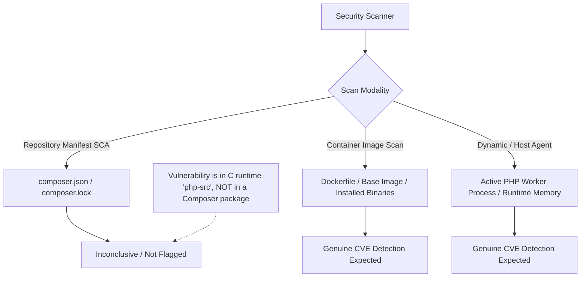
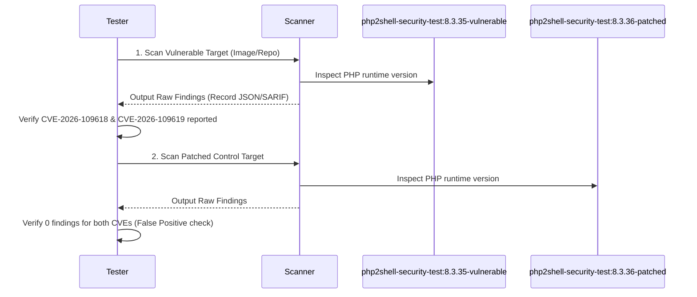

# PHP2Shell Security Scanner Validation Test Repository

A reproducible, minimal test repository designed to validate whether vulnerability scanners and security auditing tools correctly identify the two critical PHP vulnerabilities disclosed in the **Datadog Security Labs** report ([PHP2Shell: Critical vulnerabilities in PHP](https://securitylabs.datadoghq.com/articles/php2shell-critical-vulnerabilities-in-php/)).

> [!IMPORTANT]
> **Purpose & Scope:** This repository is strictly an isolated **defensive test fixture** for security tool verification and finding validation. It contains **no exploit payloads**, **no malicious request handling**, **no command execution logic**, and **no real credentials or secrets**.

---

## 1. Vulnerability Summary

On October 21, 2026, the PHP project and Datadog Security Labs disclosed two critical vulnerabilities in the core PHP runtime:

| Identifier | Upstream Advisory | CVSS v4.0 | Severity | Flaw Category | Description |
|---|---|---|---|---|---|
| **CVE-2026-109618** | [GHSA-w8hw-w9fx-j79w](https://github.com/php/php-src/security/advisories/GHSA-w8hw-w9fx-j79w) | **9.2** | Critical | Memory Corruption / RCE | Interrupted initialization after memory exhaustion during hash table insertion (`_zend_hash_str_add_or_update_i`). Incomplete buckets are visited during request cleanup. |
| **CVE-2026-109619** | [GHSA-6wmf-4rv5-p3rp](https://github.com/php/php-src/security/advisories/GHSA-6wmf-4rv5-p3rp) | **9.2** | Critical | Use-After-Free / RCE | Stale state crosses request boundaries via fatal-error backtraces (PHP 8.5) and upload progress tracking (`session.upload_progress.enabled`). |

---

## 2. Affected and Fixed Versions

According to the official PHP security release announcements and Datadog Security Labs:

| PHP Branch | Vulnerable / Affected Releases | First Fixed Release |
|---|---|---|
| **PHP 8.2** | Prior to 8.2.35 | `8.2.35` |
| **PHP 8.3** | Prior to 8.3.36 | `8.3.36` |
| **PHP 8.4** | Prior to 8.4.27 | `8.4.27` |
| **PHP 8.5** | Prior to 8.5.12 | `8.5.12` |
| **PHP 7.4 / 8.0 / 8.1** | All standard unpatched releases | Backported source patches issued |

### Selected Test Pair: PHP 8.3.35 vs PHP 8.3.36

This test repository configures **PHP 8.3** as the primary evaluation target:
- **Test A (Vulnerable runtime):** `PHP 8.3.35` (pinned image: `php:8.3.35-cli-alpine`)
- **Test B (Patched runtime control):** `PHP 8.3.36` (pinned image: `php:8.3.36-cli-alpine`)

**Rationale:**
1. **Minimizes Version Skew:** Testing adjacent patch releases (`8.3.35` vs `8.3.36`) within the active 8.3 branch ensures that scan discrepancies are strictly attributable to the CVE security patches, rather than breaking configuration changes or feature differences.
2. **Deterministic Baseline:** The 8.3 branch is actively deployed in enterprise environments and standard container registries.
3. **Control Case Validation:** `8.3.36` provides an exact control baseline to verify zero false positives on fixed runtimes.

---

## 3. Detection Mechanisms and Scanner Realities

Understanding how your security scanner functions is essential for valid interpretation of results:



### Key Detection Constraints:
1. **Core Runtime vs. Composer Packages:** CVE-2026-109618 and CVE-2026-109619 affect the compiled PHP interpreter binary itself (`php-src`), not userland Composer packages.
2. **Repository SCA Limitations:** Tools that only parse `composer.json` or `composer.lock` for third-party libraries will **not** detect these CVEs unless they explicitly parse the root PHP platform constraint or inspect the `Dockerfile`. Do not expect library-only SCA to report runtime CVEs.
3. **Container Image & Host Scanners:** Scanners that examine container image layers, operating system package managers (e.g. apk, deb), or binary version strings are the primary supported mechanism for detecting these vulnerabilities in containerized applications.
4. **Fixtures vs Scanner Findings:** The JSON files located in `fixtures/` are local reference specifications defining expected results. They do **not** represent actual scanner execution or findings.

---

## 4. Repository Structure

```
.
├── README.md                          # Documentation and test matrix
├── Dockerfile                         # Parameterized container definition (default: PHP 8.3.35)
├── docker-compose.yml                 # Multi-service setup for vulnerable and patched runtimes
├── composer.json                      # Minimal, valid PHP project manifest
├── .gitignore                         # Standard ignores (vendor, logs, scan results)
├── .dockerignore                      # Docker context exclusion list
├── src/
│   └── index.php                      # Harmless, safe JSON status endpoint
├── fixtures/
│   ├── vulnerable-runtime.json        # Test A metadata and expected detection behavior
│   └── patched-runtime.json           # Test B metadata and expected clean behavior
└── scripts/
    └── verify.sh                      # Harmless local integrity and configuration verification script
```

---

## 5. Setup and Local Verification

### Prerequisites
- Docker (version 20.10+) and Docker Compose (v2+)
- Bash
- `jq` or `python3` (for JSON validation)

### Step 1: Run Local Integrity Checks
Verify repository structure and test metadata without making external calls:
```bash
./scripts/verify.sh
```

### Step 2: Build the Container Images
Build both the vulnerable and patched container targets:
```bash
# Build vulnerable target (Test A)
docker compose build vulnerable-runtime

# Build patched control target (Test B)
docker compose build patched-runtime
```

### Step 3: Run the Application (Optional Verification)
Start the harmless status endpoint:
```bash
docker compose up -d vulnerable-runtime
curl http://127.0.0.1:8081
docker compose down
```

The response is a harmless JSON object:
```json
{
  "application": "php2shell-security-test",
  "status": "healthy",
  "php_version": "8.3.35",
  "target_advisories": [
    "CVE-2026-109618",
    "CVE-2026-109619"
  ]
}
```

---

## 6. Security Scanner Validation Workflow

Follow this procedure to test your security scanning platform (e.g., container vulnerability scanners, cloud workload protection, or repository security scanners):



### Execution Steps

1. **Scan Vulnerable Runtime (Test A):**
   Execute your scanner against the container image or repository:
   ```bash
   # Example container scanning syntax (replace with your tool's CLI):
   # <scanner-cli> image scan php2shell-security-test:8.3.35-vulnerable --output scan-results/vuln-scan.json
   ```
2. **Record Raw Findings:**
   Save raw scanner output (JSON/SARIF/text) in a dedicated directory:
   ```bash
   mkdir -p scan-results
   ```
3. **Check for Targeted Identifiers:**
   Confirm whether the scanner output contains:
   - `CVE-2026-109618`
   - `CVE-2026-109619`
4. **Scan Patched Runtime Control Case (Test B):**
   Scan the patched image:
   ```bash
   # <scanner-cli> image scan php2shell-security-test:8.3.36-patched --output scan-results/patched-scan.json
   ```
5. **Compare Results and Evaluate False Positives:**
   Verify that neither CVE is reported against `8.3.36`.

---

## 7. Expected Results Matrix

| Test Configuration | Target Version | Expected Outcome | Technical Interpretation |
|---|---|---|---|
| **Vulnerable Runtime (CVE-2026-109618)** | PHP 8.3.35 | **Finding Expected** | Pass if scanner supports runtime/container scanning and its advisory database contains GHSA-w8hw-w9fx-j79w. |
| **Vulnerable Runtime (CVE-2026-109619)** | PHP 8.3.35 | **Finding Expected** | Pass if scanner supports runtime/container scanning and its advisory database contains GHSA-6wmf-4rv5-p3rp. |
| **Patched Runtime Control** | PHP 8.3.36 | **No Finding Expected** | Fixed release. Any reported finding on 8.3.36 indicates an inaccurate version comparison rule (false positive). |
| **Repository-Only SCA (Manifest Only)** | `composer.json` | **Inconclusive / Unsupported** | Standard package SCA scans Composer packages. The PHP interpreter is not a Composer library. Not a test failure. |
| **Scanner reports only one CVE** | PHP 8.3.35 | **Partial Detection** | Investigate advisory feed update frequency and mapping between GHSA and CVE IDs. |

### Diagnostic Guidelines: Interpreting Negative Results
A scanner's failure to report a finding does **not** automatically prove that the scanner is defective. Before concluding failure, verify:
1. **Advisory Database Freshness:** Are advisories dated October 21, 2026 synced into the scanner's local/remote vulnerability database?
2. **Scanner Detection Scope:** Does the scanner inspect container base images / system binaries, or does it only inspect language package manifests (`composer.json`)?
3. **Runtime Visibility:** For dynamic scanners, is the agent able to observe worker process versions?

---

## 8. Cleanup

Remove created test containers, images, and network resources:
```bash
docker compose down --volumes --rmi local
```

---

## 9. References

- [Datadog Security Labs: PHP2Shell - Critical vulnerabilities in PHP](https://securitylabs.datadoghq.com/articles/php2shell-critical-vulnerabilities-in-php/)
- [PHP Security Advisory: GHSA-w8hw-w9fx-j79w (CVE-2026-109618)](https://github.com/php/php-src/security/advisories/GHSA-w8hw-w9fx-j79w)
- [PHP Security Advisory: GHSA-6wmf-4rv5-p3rp (CVE-2026-109619)](https://github.com/php/php-src/security/advisories/GHSA-6wmf-4rv5-p3rp)
- [PHP Official Announcement](https://www.php.net/archive/2026.php#2026-10-21-1)
